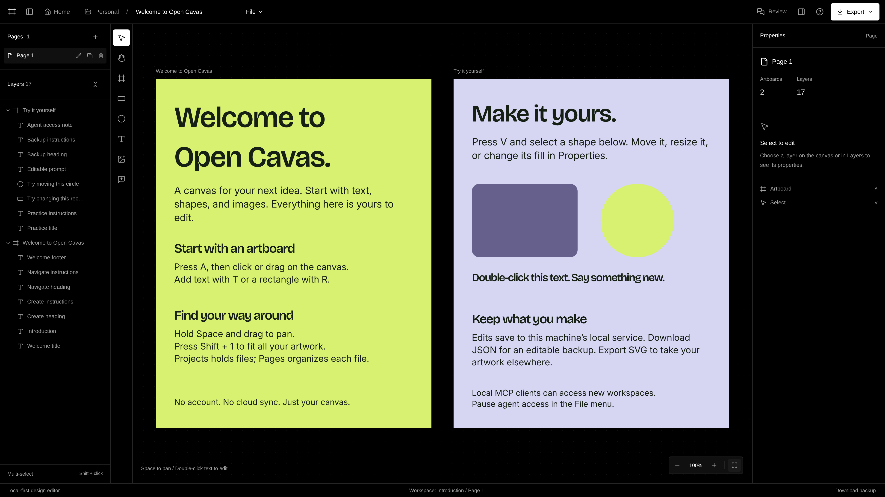

# Open Canvas

Open Canvas is a local-first design editor that runs in your browser. Make artboards with editable text, shapes, and images, then export artwork or save an editable backup. No account or cloud service required.

[Install](#install) · [Start designing](#start-designing) · [Connect an agent](#connect-an-agent) · [Changelog](apps/web/CHANGELOG.md) · [Website](https://open-canvas.xyz)



## Install

Release archives bundle the editor, local workspace service, and Node.js. You do not need Git, npm, or pnpm to run them. The shell installer targets macOS and glibc-based Linux on x64 and ARM64. A PowerShell installer targets Windows on x64 and ARM64. It has been run in CI on Windows Server 2025 (x64) and Windows 11 (ARM64) only; see [verification](docs/verification.md#windows-package).

Once the [latest public release](https://github.com/utpalsinghdev/open-canvas/releases/latest) includes the archive and checksum for your platform, run:

```sh
curl -fsSL https://raw.githubusercontent.com/utpalsinghdev/open-canvas/main/scripts/install.sh | bash
open-canvas
```

`open-canvas` opens `http://127.0.0.1:5190` in your browser. Keep the terminal running while you work. If the command is not on PATH, run `~/.local/bin/open-canvas` instead.

On Windows, run this in PowerShell instead:

```powershell
irm https://raw.githubusercontent.com/utpalsinghdev/open-canvas/main/scripts/install.ps1 | iex
open-canvas
```

Online installation is not available until the installer and release assets are publicly readable. See [installation instructions](docs/install.md) to inspect the script before running it or install a trusted local archive. Use [CONTRIBUTING.md](CONTRIBUTING.md#run-stable-main-from-source) if you need to run from source.

## Start designing

1. In the workspace chooser, choose **Start with introductory canvas** to open two editable artboards. Choose **Create empty workspace** to start from scratch.
2. Draw an artboard (`A`), rectangle (`R`), ellipse (`O`), or text (`T`). Click for the default size or drag to set dimensions. Use **Add image** to insert an image file.
3. Select a layer to move or resize it, or enter exact values in **Properties**. Double-click text to edit it. Hold `Space` and drag to pan; use `Shift+1` to fit your work in view.
4. Use **Home** to browse projects and files, **Pages** above Layers to organize a file, and **Help** in the header for shortcuts and the current version’s changelog.

Use **Add comment** to leave feedback on a layer or canvas position. **Review** lists threads across the file so you can reply, jump to a comment, or resolve it. See the [introductory canvas](docs/introduction.md) and [review controls](docs/review-threads.md). Menus, Review and messages ease in and out briefly; turning on your system's reduced-motion setting makes them change immediately. See [editor motion](docs/editor-motion.md).

## Save, back up, and export

- **Keep editing later:** changes save to your selected local workspace. The chooser and Projects show the exact save location. Fresh installed workspaces live under `~/.open-canvas/data/`.
- **Keep an editable copy:** choose **File → Download JSON** for the full file, including its pages. Use the project or workspace backup controls for a larger backup. Import JSON to open an editable copy.
- **Share artwork:** use **Export** for SVG or PDF. The menu shows whether it will export the selection or current page. PDF output is raster artwork, not selectable text or vector paths. See [PDF export](docs/pdf-export.md).

To recover older browser-only work, reopen its original browser profile and exact URL, then use **Copy browser workspace**. See [local workspaces and recovery](docs/local-workspaces.md) before moving or deleting saved data.

## Connect an agent

```sh
open-canvas mcp-config
```

Copy the generated `open-canvas` entry into your MCP client. Open a workspace in the editor to connect its canvas automatically. Local MCP clients can find and edit saved workspaces without a browser tab; browser rendering needs a connected canvas. Use **File → Pause agent access** to turn off MCP access for the selected workspace.

The browser does not send your projects to a cloud service. Only use trusted local MCP clients and do not expose the editor to the public internet. See [MCP setup and security](docs/mcp.md) for details.

## Updates and release notes

```sh
open-canvas update --check   # Check without downloading
open-canvas changelog        # Read bundled history offline
open-canvas changelog --latest  # Read the latest public release notes
```

To update, save your work, stop the editor and its MCP clients, then run `open-canvas update`. It verifies the archive and version before switching and does not restart running sessions. See [update and rollback instructions](docs/install.md#update-roll-back-or-remove).

## Current limits

Open Canvas is designed for desktop browsers. Narrow layouts provide access to editor panels, but touch gestures are limited. Cloud sync, live collaboration, auto layout, vector path editing, and editable third-party design-file import are not supported. See the [product scope](PRODUCT.md), [document format](docs/document-format.md), and [MCP capabilities](docs/mcp-capabilities.md) for more detail.

## Contribute

See [CONTRIBUTING.md](CONTRIBUTING.md) for source setup, development, checks, and pull requests. Report problems in [GitHub Issues](https://github.com/utpalsinghdev/open-canvas/issues).

## Support Open Canvas

If Open Canvas is useful to you, you can support its development by buying me a coffee.

<a href="https://buymeacoffee.com/utpalsinghdev">
  
</a>

[Apache License 2.0](LICENSE)
