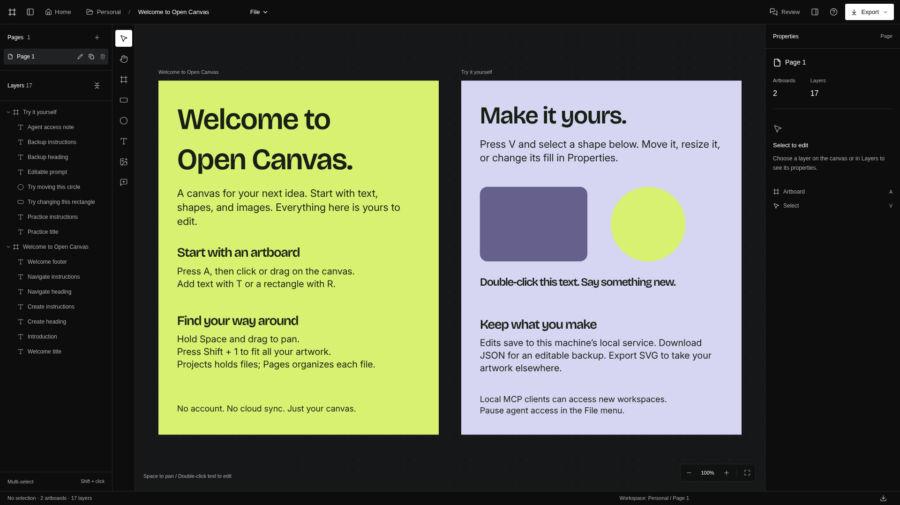

# Introductory canvas

The introduction is an ordinary editable design file, not a welcome webpage or a Help dialog. In the local workspace chooser, choose **Start with introductory canvas** to create a new workspace containing the **Welcome to Open Canvas** file. The editor opens its first page and fits the artwork into view.

## Artwork and content

Two artboards contain 17 native layers:

- **Welcome to Open Canvas** introduces artboards, text, shapes, pan/fit shortcuts, Projects, and Pages.
- **Try it yourself** contains a movable circle, a rectangle with an editable fill, and text to rewrite. It also explains local saves, JSON backups, SVG exports, and automatic local MCP access with File-menu pause controls.

Every heading, paragraph, shape, and artboard is editable. Select layers from the canvas or Layers panel, move/resize shapes, edit text, change Properties, undo changes, or export the artwork using the normal editor controls. There are no simulated buttons or separate tutorial states. On narrow screens, zoom and pan to read or edit individual artboards.

## Creation and persistence

The seed lives in `packages/engine/src/seed.ts`. It replaces the old synthetic poster study used as the fresh-browser fallback. The chooser also offers explicit seeded service-workspace creation, so starting with the introduction does not require copying browser storage. Each creation generates fresh layer, file, page, project, and workspace IDs.

**Create empty workspace** remains empty. **Copy browser workspace** preserves existing browser content and identity. Opening an existing service workspace or direct file link never inserts introductory artwork. The introduction is not automatically added to new files or to workspaces created through MCP.

After creation, the file uses ordinary local service persistence and JSON backups. Deleting or editing its layers is permanent after saving unless undone within the current file session. Reloading does not recreate the seed or restore deleted introduction layers. There is no dismissal preference, separate onboarding screen, or Help introduction section.

Copy and artwork are original and describe supported Open Canvas behavior.
